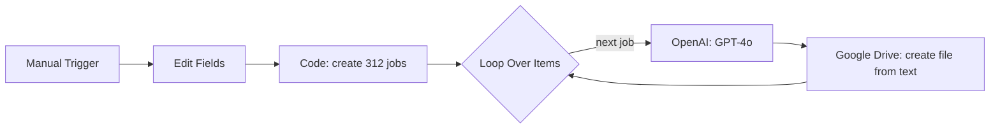

# Bulk Article Generator (n8n + GPT-4o)

n8n workflow that generates a batch of English articles for crowd-marketing and Web 2.0 placements and saves each article as a separate file in Google Drive. The default batch is 312 articles per run.

[Описание на русском](#на-русском)

## How it works

- For each job GPT-4o picks a popular 2025–2026 topic in the online casino niche (bonuses, slots, live dealer games, crypto payments, mobile apps and similar) and writes an article of 800–1,500 words.
- Structure: intro, 2–3 sections with subheadings, conclusion. No keyword stuffing.
- The client brand is mentioned exactly once in the whole text.
- Output is plain text only: no Markdown, bold, hashtags or bullet symbols, so it can be pasted into any editor.
- Each article is saved to the chosen Drive folder as `article_<yyyy-MM-dd_HH-mm-ss>`.

## Setup

1. Import `3_Ai_text_generator.sanitized.json` into n8n.
2. Connect OpenAI and Google Drive credentials and set the folder ID in **Create file from text**.
3. Replace `{{CLIENT_BRAND}}` in the prompt of **Message a model** with the brand name.
4. To change the batch size, edit the loop limit in **Code in JavaScript** (312 by default).

## Stack

n8n · OpenAI (GPT-4o, Message a model node) · Google Drive API · JavaScript (Code node)

## На русском

n8n-воркфлоу для массовой генерации статей под крауд-маркетинг и Web 2.0. За один запуск создаёт 312 заданий. По каждому GPT-4o сам выбирает популярную тему в нише онлайн-казино и пишет статью на 800–1 500 слов с одним упоминанием бренда клиента, без markdown-разметки. Каждая статья сохраняется отдельным файлом в Google Drive.

Перед запуском замени `{{CLIENT_BRAND}}` в промпте на название бренда. Число статей меняется в Code-ноде.
